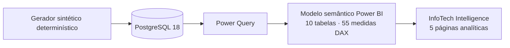
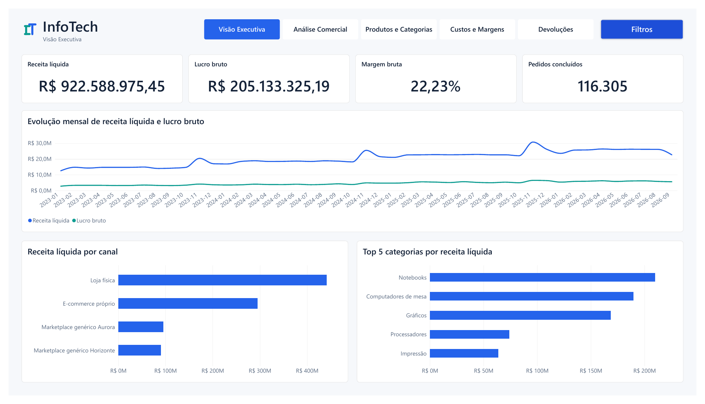
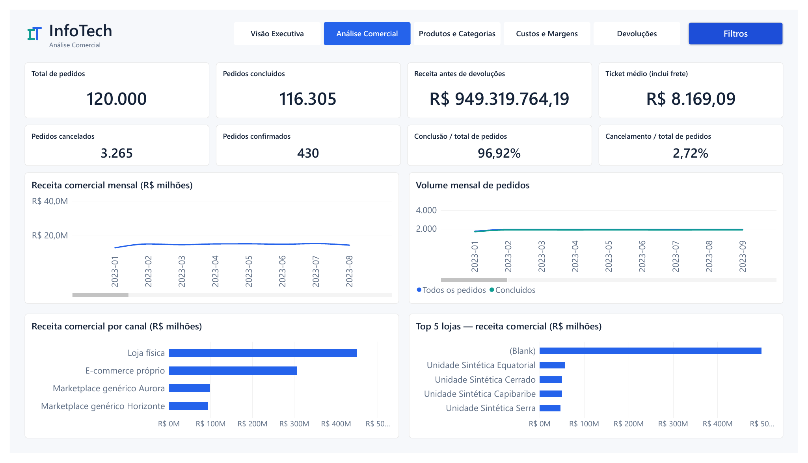
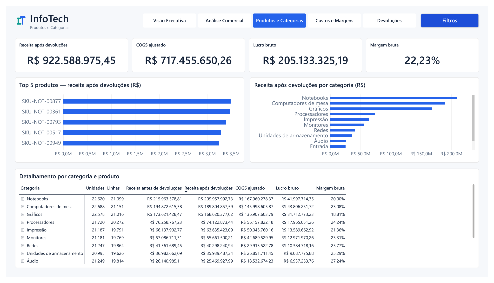
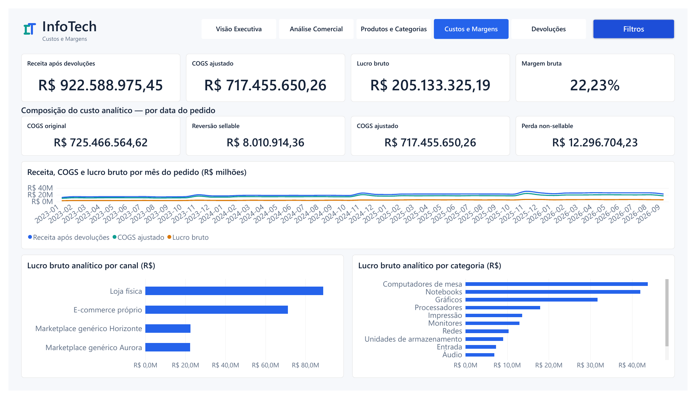
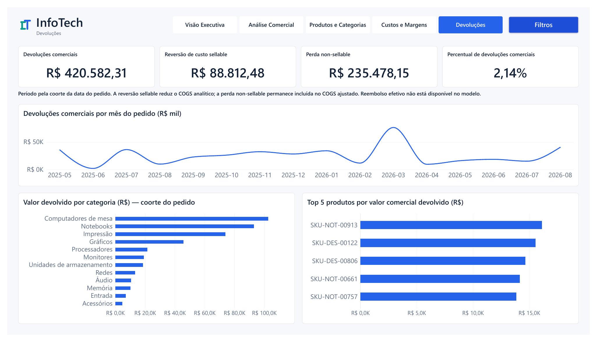

# ProjetoBI — Business Intelligence com desenvolvimento assistido por IA

**InfoTech Intelligence** é um projeto de estudo de ponta a ponta em Business Intelligence, construído para uma empresa fictícia do segmento de informática.

> **Em desenvolvimento · Primeira demonstração · Dados 100% sintéticos**

O ProjetoBI demonstra como uma operação comercial pode ser modelada em PostgreSQL e explorada com Power BI, com atenção à integridade dos dados, rastreabilidade das métricas e evolução incremental do produto. O trabalho combina implementação e revisão humanas com assistência de IA; decisões, escopo e validações permanecem sob supervisão humana.

## O que o projeto demonstra

- Uma base operacional coerente com **41 tabelas** em PostgreSQL.
- Um modelo semântico Power BI com **10 tabelas**: quatro fatos, cinco dimensões e a tabela `_Medidas`.
- **55 medidas DAX** e 21 relacionamentos documentados.
- Dados inteiramente sintéticos, com 120.000 pedidos aceitos e período comercial de 1º de janeiro de 2023 a 30 de setembro de 2026.
- Cinco páginas analíticas voltadas a perguntas executivas, comerciais, de produto, custos e devoluções.

As 41 tabelas operacionais e as 10 tabelas semânticas são camadas diferentes: a primeira representa processos da operação; a segunda organiza a análise. O modelo não converte o banco operacional em um esquema estrela.

## Arquitetura

## Galeria

As imagens abaixo são renderizações rasterizadas das cinco páginas exportadas pelo Power BI para PDF na Fase 5.7.2, em 15 de outubro de 2026. São evidência visual derivada daquela exportação, não capturas atuais da janela do Desktop. A homologação posterior do PBIX está descrita em [Fase 5.7.2.1](docs/powerbi/phase-5.7.2.1-public-pbix-closure.md). [Abrir o PDF de origem](docs/powerbi/evidence/phase-5.7.2/pbix-exportado-powerbi.pdf).

### Visão Executiva

Visão de receita, lucro, margem, pedidos concluídos e tendências consolidadas.

### Análise Comercial

Exploração de pedidos, receita, canais, lojas e evolução comercial.

### Produtos e Categorias

Comparação de desempenho entre produtos e categorias.

### Custos e Margens

Leitura de custos, lucro e margem por período e recortes comerciais.

### Devoluções

Análise de valores devolvidos e seus efeitos comerciais e financeiros.

## Demonstração

O PBIX demonstrativo local contém dados sintéticos incorporados e foi homologado parcialmente. A abertura, as cinco páginas, os filtros e a persistência foram verificados no Power BI Desktop; o teste em ambiente isolado sem PostgreSQL continua pendente. A correção atual define `FitToPage` como alvo no PBIP versionado, mas a validação no Desktop e a regeneração do PBIX ainda não foram concluídas. Não use o PBIX anterior como se contivesse essa correção. Consulte o [guia do PBIX](docs/portfolio/PBIX_DEMO_GUIDE.md) e a [minuta de Release](docs/portfolio/GITHUB_RELEASE_DRAFT.md); nenhum arquivo foi publicado.

## Desenvolvimento assistido por IA

Ferramentas de IA auxiliaram análise, implementação, documentação e testes dentro de escopos definidos e revisados por uma pessoa. O processo incluiu validação manual e correções iterativas; por exemplo, foram corrigidos erros de conversão no Power Query, serialização de bookmarks e legibilidade visual. Isso não significa desenvolvimento autônomo, nem constitui uma medição de produtividade.

## Acessibilidade e limitações

A acessibilidade recebeu refinamentos, mas permanece **parcial**: o projeto não declara conformidade WCAG nem homologação universal em dispositivos móveis. As páginas foram concebidas em Full HD. Algumas limitações de densidade e escala dos visuais estão registradas na documentação do Design System.

O projeto segue em desenvolvimento. Experimentos futuros com HTML ou visuais personalizados não fazem parte desta demonstração. O conteúdo original do projeto, nos limites dos direitos do titular, está sob a [licença MIT](LICENSE), que permite uso, cópia, modificação, distribuição, sublicenciamento e venda mediante preservação dos avisos de copyright e licença. Bibliotecas, marcas e outros materiais de terceiros mantêm suas próprias condições e não recebem automaticamente a licença MIT do projeto.

## Tecnologias e documentação

- PostgreSQL 18 e SQL para a camada operacional.
- Python para geração de dados sintéticos determinísticos.
- Power BI Desktop, Power Query, modelo semântico, DAX, PBIR e TMDL.
- Git para histórico e documentação incremental.

Documentos de referência:

- [Plano mestre do projeto](docs/PROJECT_COMPLETION_PLAN.md)
- [Arquitetura do banco](docs/database/)
- [Design System InfoTech v0.3](docs/powerbi/phase-5.6c-design-system-v0.3.md)
- [Relatório de preparação da apresentação pública — Fase 5.8](docs/powerbi/phase-5.8-first-public-presentation.md)

Nenhuma instância pública ou publicação foi criada nesta etapa.
