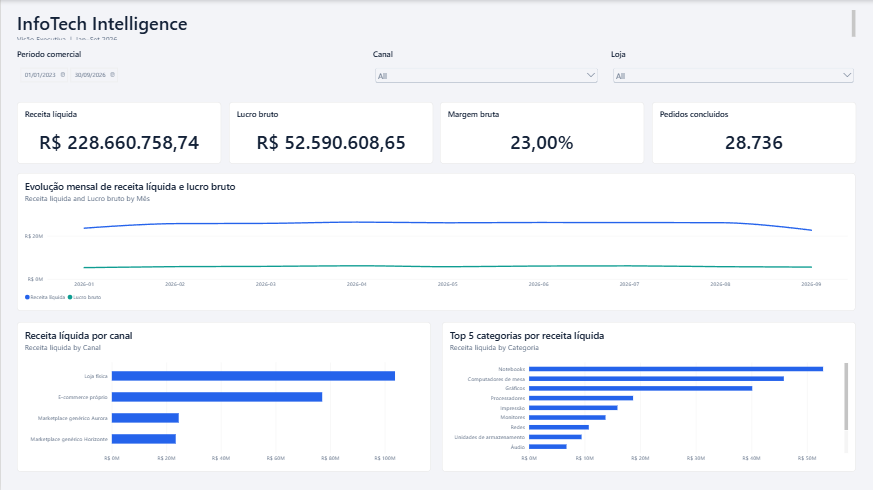
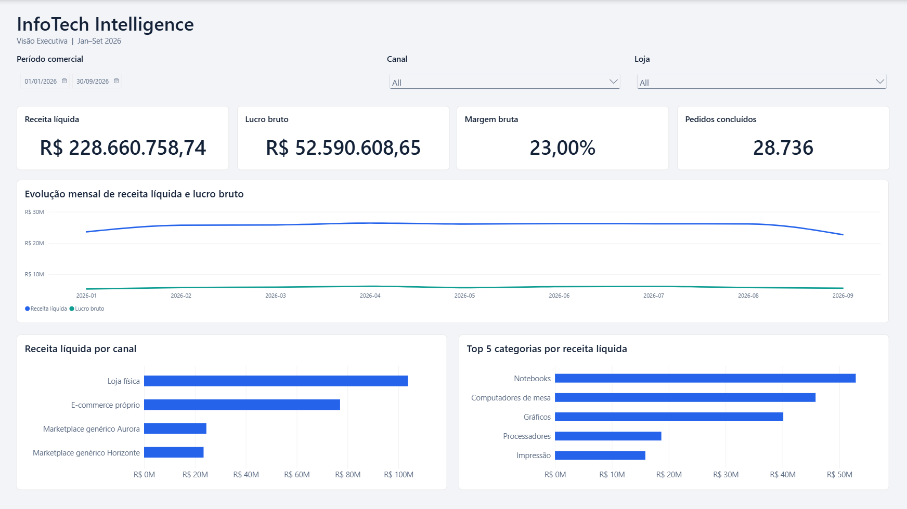

# Fase 5.1.1 — Refinamento visual e validação da Visão Executiva

**Status:** `FASE 5.1.1 PARTIAL — VALIDATION PENDING`
**Data:** 2026-10-12
**Projeto:** `powerbi/ProjetoBI.pbip`
**Página:** Visão Executiva, canvas 1920 × 1080, `FitToPage`

## Resultado

Os ajustes visuais foram aplicados e a página foi carregada no Power BI Desktop pelo bridge local. A captura após a atualização mostra o intervalo inicial correto, os quatro cartões, os filtros sem rótulos repetidos e o gráfico Top 5 com cinco categorias e sem barra de rolagem. Uma consulta DAX somente leitura ao modelo local reconciliou os KPIs do período Jan–Set/2026. A fase permanece parcial porque não foi possível operar os filtros por mouse/teclado, executar o Performance Analyzer nem confirmar o ciclo normal de salvar, fechar e reabrir.

## Alterações PBIR

- Canvas preservado em Full HD (1920 × 1080), `FitToPage`.
- Cabeçalho principal aumentado para 30 pt; altura ampliada para que o subtítulo fixo caiba inteiro.
- Barra de filtros alinhada: Período comercial em 760 × 96 px; Canal em 500 × 96 px; Loja em 540 × 96 px. O intervalo foi configurado como `Between`, com 01/01/2026–30/09/2026 visíveis. Canal e Loja usam dropdowns nativos. O cabeçalho de campo dos slicers está oculto para deixar um único rótulo por controle; a seleção inicial aparece como `All` nos dropdowns.
- Títulos dos gráficos em 16 pt; eixos em 12–13 pt; legenda temporal em 13 pt; Segoe UI/Segoe UI Semibold. Subtítulos automáticos redundantes foram ocultados.
- O cartão Pedidos concluídos mantém o formato `#,##0` e agora usa precisão visual 0; o resultado aparece como `28.736`.
- Texto alternativo descritivo configurado nos onze visuais nativos. A navegação continua com tab order 0–10; operação por teclado e leitor de tela ainda não foi exercitada.
- Top N corrigido para o filtro visual nativo `VisualTopN` com contagem 5. A medida usada pelo único valor do gráfico é `Receita Analítica Após Devoluções`, e a ordenação do visual é decrescente.
- Preservadas as 10 tabelas, 55 medidas, 21 relações, consultas Power Query e fontes. Nenhum DAX, TMDL semântico ou objeto PostgreSQL foi alterado nesta fase.

## Reconciliação DAX — somente leitura

Consulta executada no mecanismo local do Power BI Desktop, com filtro explícito `DimCalendario[Data]` entre 01/01/2026 e 30/09/2026:

| Indicador | Resultado consultado | Exibição no cartão |
|---|---:|---:|
| Receita líquida | R$ 228.660.758,74 | R$ 228.660.758,74 |
| Lucro bruto | R$ 52.590.608,6501576 | R$ 52.590.608,65 |
| Margem bruta | 22,9994027% | 23,00% |
| Pedidos concluídos | 28.736 | 28.736 |

A consulta `TOPN(5)` no mesmo contexto retornou exatamente estas categorias, sem empate no limite:

| Posição | Categoria | Receita líquida |
|---:|---|---:|
| 1 | Notebooks | R$ 52.875.028,39 |
| 2 | Computadores de mesa | R$ 45.812.564,42 |
| 3 | Gráficos | R$ 40.133.439,31 |
| 4 | Processadores | R$ 18.699.848,915 |
| 5 | Impressão | R$ 15.890.542,42 |

## Matriz de validação

| Verificação | Resultado | Evidência / limite |
|---|---|---|
| Canvas Full HD e abertura da página | Passou | Página 1920 × 1080; Desktop bridge conectou ao PBIP e capturou Visão Executiva. |
| Data inicial e modo Between | Passou visualmente | Captura mostra 01/01/2026–30/09/2026; DAX do baseline coincide com esse intervalo. |
| Canal/Loja como dropdowns e sem rótulo duplicado | Passou visualmente | Captura mostra ambos como dropdowns nativos com seleção inicial `All`. A abertura da lista e a limpeza não foram testadas. |
| Títulos/eixos e remoção de subtítulos | Passou visualmente | Captura após ajuste; sem avaliação em outros monitores/escala. |
| Cartões do estado inicial | Passou | Renderização e reconciliação DAX independentes acima. |
| Top 5 decrescente, sem rolagem | Passou | Captura mostra cinco barras; consulta DAX independente retornou as mesmas cinco categorias. |
| Atualizar período para 2025 | Pendente | Não foi possível manipular o slicer nesta sessão. |
| Canal, Loja e combinação | Pendente | Não foi possível manipular os dropdowns nesta sessão. |
| Seleção de categoria protegendo Pedidos | Parcial | `visualInteractions` declara `NoFilter` para categoria → cartão; interação no Desktop pendente. |
| BLANK/zero e limpeza dos filtros | Pendente | Não exercitado no Desktop. |
| Acessibilidade operacional | Parcial | Texto alternativo e tab order configurados; foco por teclado, leitor de tela e contraste operacional pendentes. |
| Performance Analyzer | Pendente | Não medido nesta sessão. |
| Salvar, fechar normalmente e reabrir | Pendente | O bridge recarregou a definição e capturou a renderização; não automatiza o fechamento normal do Desktop nesta sessão. |
| Integridade do modelo | Passou estaticamente | 10 tabelas, 55 medidas e 21 relações preservadas; DAX somente leitura. |

## Capturas

A captura de diagnóstico mostra o estado antes da correção do Top 5 e do limite inferior visível do período. A captura final é a página renderizada pelo Desktop após as correções.

## Validação de arquivos e limitações

- Todos os JSON do relatório foram analisados pelo parser local após as edições; reload e screenshot pelo Desktop bridge tiveram sucesso.
- `powerbi-report-author validate` não passou integralmente: reportou dois arquivos legados sem `$schema` (`ProjetoBI.pbip` e `definition.pbir`) e uma divergência entre o nome interno do tema e o nome do recurso registrado; também avisou que não conseguiu buscar o schema de alguns visuais. O projeto abriu e renderizou no Desktop. Esses diagnósticos preexistem ao trabalho visual desta fase e não foram alterados aqui.
- Não houve atualização de dados, acesso ao PostgreSQL, alteração de credenciais ou publicação.
- A captura completa desta sessão foi obtida no Desktop após o reload PBIR; o fechamento/reabertura normais ainda precisam de confirmação final.

## Design System e Git

O `INFOTECH_DESIGN_SYSTEM.md` permanece em v0.1. A mudança para v0.2 fica reservada à homologação após os testes de interação, acessibilidade, desempenho e persistência que ainda estão pendentes. As alterações preexistentes em `report.json`, `pt-BR.tmdl` e no JSON do título foram preservadas e ficaram fora do commit desta fase.

**Classificação:** `FASE 5.1.1 PARTIAL — VALIDATION PENDING`

## Fechamento posterior — Fase 5.1.2

Em 2026-10-12, o usuário confirmou a aprovação manual dos sete cenários. A ressalva de tipografia foi refinada; o cabeçalho deixou de indicar um período fixo. A Visão Executiva e o Design System v0.2 foram homologados no alcance documentado em [phase-5.1.2-executive-dashboard-homologation.md](phase-5.1.2-executive-dashboard-homologation.md). A classificação PARTIAL acima permanece como registro histórico do encerramento original da Fase 5.1.1.
