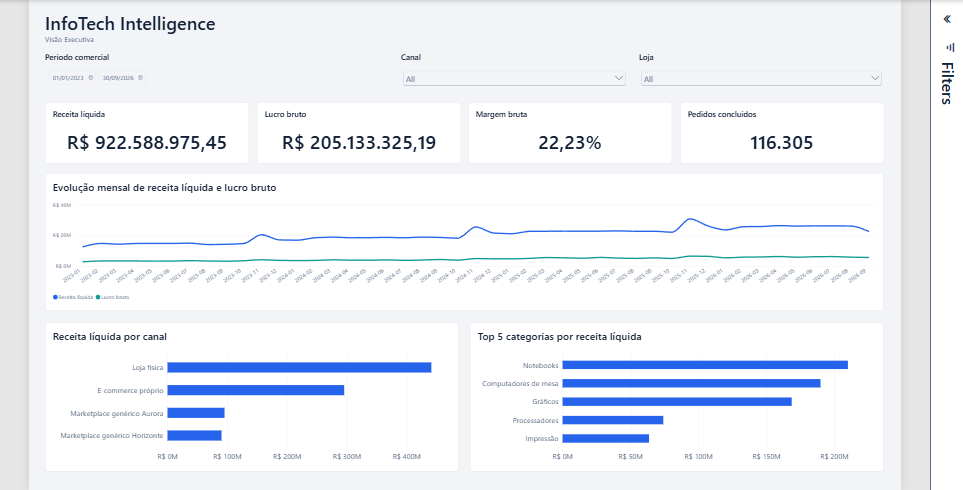
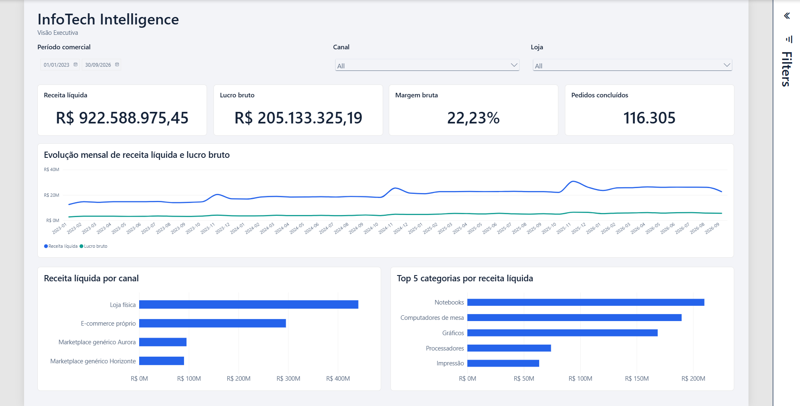

# Fase 5.1.2 — Homologação da Visão Executiva e Design System v0.2

**Classificação:** `FASE 5.1.2 PASS — EXECUTIVE DASHBOARD HOMOLOGATED`

**Data:** 2026-10-12 — America/Sao_Paulo

**Checkpoint anterior:** `293ade6` — refinamento da Fase 5.1.1, originalmente PARTIAL.

## Evidência e alcance da aprovação

O complemento de execução do usuário afirma que os sete testes foram concluídos sem problemas funcionais. Esse relato é registrado como aprovação manual dos cenários, sem criar valores, teclas, estados de foco ou registros individuais que não foram fornecidos. A ressalva visual foi fonte pequena, especialmente nos eixos; os três gráficos foram refinados e reinspecionados por captura do Power BI Desktop nesta fase.

Também foi encontrada a exportação local `PowerBIPerformanceData.json`. Ela registra ações e durações da sessão dos testes anteriores ao refinamento tipográfico. A aprovação manual, a exportação de desempenho, as propriedades PBIR e a captura são evidências distintas; nenhuma delas é apresentada como uma auditoria completa de acessibilidade ou benchmark de produção.

## Sete testes de homologação

As ações abaixo identificam os cenários que o usuário confirmou globalmente. Não há log detalhado por seleção ou valores intermediários recuperáveis.

| Teste | Cenário aprovado | Resultado | Evidência e limite |
|---|---|---|---|
| Período | Alterar para 2025 e restaurar Jan–Set/2026 | PASS manual | Relato explícito de sete testes sem problemas. O estado local salvo depois está com seleção de período limpa; essa diferença é preservada. |
| Canal | Selecionar canal, atualizar indicadores e limpar | PASS manual | Relato global; exportação contém ações de slicer, sem identificar qual canal em cada evento. |
| Loja | Selecionar loja e conferir indicadores | PASS manual | Relato global; nenhum valor específico de loja foi fornecido. |
| Filtros combinados | Período + Canal + Loja | PASS manual | Relato global; combinações individuais não estão discriminadas. |
| Categoria | Interação financeira e proteção de Pedidos concluídos | PASS manual | Relato global; PBIR mantém `NoFilter` de categoria para Pedidos. O log contém três ações de cross-highlight, sem identificação detalhada da seleção. |
| Acessibilidade e desempenho | Navegação por teclado e observações do Performance Analyzer | PASS manual, com limitações | Relato de aprovação do cenário; exportação disponível e resumida abaixo. Não comprova leitor de tela, todas as teclas ou todos os estados de foco. |
| Persistência | Salvar, fechar normalmente e reabrir | PASS manual | Relato do usuário. O Desktop estava fechado no preflight; após as alterações desta fase, o PBIP foi aberto pelo bridge e capturado com sucesso. Não se inventa um segundo ciclo manual posterior. |

Não foi necessário repetir os sete cenários. A mudança técnica desta fase se limita à apresentação e ao texto de contexto; queries, filtros, KPIs e interações aprovadas foram preservados.

## Refinamento técnico e visual

| Elemento | Antes | Final verificado |
|---|---|---|
| Eixos da linha mensal | 13 pt | 16 pt nos eixos X/Y |
| Categorias das barras | 13 pt | 16 pt nos dois gráficos |
| Eixos monetários das barras | 12 pt | 16 pt nos dois gráficos |
| Títulos dos gráficos | 16 pt | 17 pt, Segoe UI Semibold |
| Legenda temporal | 13 pt | 15 pt, Segoe UI |
| Unidade dos eixos financeiros | Automática; canal podia exibir bilhões | Milhões explícitos, precisão visual zero; sufixo nativo `M` |
| Subtítulo do cabeçalho | Visão Executiva / Jan–Set 2026 | Somente Visão Executiva |
| Texto alternativo do cabeçalho | Referência fixa a Jan–Set/2026 | Descrição de análise no período selecionado |

O cabeçalho anterior era estático e podia contrariar o intervalo escolhido. A retirada do período resolve esse risco sem medida DAX nova. O período é informado pelo slicer.

Canvas 1920 × 1080, fundo `#F5F7FB`, posições e dimensões dos onze visuais foram mantidos. A captura mostra os quatro canais com nomes completos, cinco categorias, ausência de scrollbar no ranking e ausência de cortes ou sobreposição nos títulos. Não foi necessário comprimir filtros ou cartões para aumentar as fontes.

### Escala e restrição do eixo temporal

A página foi avaliada com sua configuração `FitToPage`, em capturas escala 1 (963 × 490 px) e 2 (1926 × 980 px) do bridge. O canvas lógico permanece Full HD. A captura escala 2 permite inspeção de detalhe, mas não equivale a operar o zoom do Desktop em 100% nem a mudar o monitor.

No estado local sem restrição temporal, são 45 meses de 2023-01 a 2026-09. O visual nativo inclina os rótulos, que permanecem densos quando a página inteira é reduzida para um viewport pequeno. Não houve supressão de pontos ou mudança de grão. Essa apresentação de longos intervalos em tela reduzida é uma limitação documentada, não um padrão universal homologado; usar janela temporal apropriada ou maior área de apresentação para leitura de cada mês.

## Contexto dos valores e contratos preservados

A reconciliação DAX independente da Fase 5.1.1 permanece a evidência dos valores de Jan–Set/2026: receita R$ 228.660.758,74; lucro R$ 52.590.608,65; margem 23,00%; Pedidos concluídos 28.736. Não foi reexecutada auditoria financeira completa, pois não houve mudança de cálculo, query, relação ou filtro nesta fase.

O ranking de referência nesse intervalo permanece Notebooks, Computadores de mesa, Gráficos, Processadores e Impressão. O visual mantém `VisualTopN.ItemCount=5` e ordenação decrescente pela Receita Analítica Após Devoluções. A captura atual também mostra essas cinco categorias, no contexto salvo sem restrição de período.

A seleção temporal limpa é uma alteração local preexistente dos testes. Por isso, a captura atual cobre 2023-01-01–2026-09-30 e exibe R$ 922.588.975,45 de receita, R$ 205.133.325,19 de lucro, 22,23% de margem e 116.305 pedidos. Esses são valores observados na captura, não uma nova reconciliação DAX nem substituição do baseline Jan–Set/2026.

A verificação estática contou 10 tabelas, 55 medidas, 11 Display Folders e 21 relações. As definições de query, sort, filtros e posições dos três gráficos foram comparadas antes/depois e permanecem iguais; o `NoFilter` categoria → Pedidos está preservado. Nenhuma fórmula DAX, Power Query, fonte, credencial ou objeto PostgreSQL foi alterado.

## Desempenho disponível

Fonte local: `docs/powerbi/PowerBIPerformanceData.json`, versão 1.1.0, 1.562 eventos; SHA-256 `17CE5248294B9AA840C41AD7918D113EE34118281650F6C38591A8C6D95BAD22`.

Janela: 2026-10-12, 22:49:55.239–22:50:17.658, America/Sao_Paulo. O arquivo registra 11 ações `ChangeSlicer`, três `CrossHighlight` e início de monitoramento. Foram calculadas durações `end − start` de 153 eventos completos `Visual Container Lifecycle`:

| Visual | Amostras | Mínimo (ms) | Máximo (ms) | Média (ms) |
|---|---:|---:|---:|---:|
| Período | 14 | 112 | 354 | 182,36 |
| Canal | 15 | 46 | 237 | 124,80 |
| Loja | 15 | 45 | 258 | 124,13 |
| Receita líquida | 14 | 134 | 376 | 216,57 |
| Lucro bruto | 14 | 133 | 376 | 216,43 |
| Margem bruta | 14 | 133 | 377 | 222,00 |
| Pedidos concluídos | 14 | 133 | 290 | 198,14 |
| Tendência mensal | 14 | 165 | 408 | 274,79 |
| Receita por canal | 14 | 163 | 407 | 276,29 |
| Top 5 categorias | 11 | 162 | 354 | 255,73 |
| Textbox | 14 | 70 | 226 | 116,71 |

O [resumo derivado](evidence/phase-5.1.2-performance-summary.json) preserva hash, proveniência, contagens e método. O arquivo bruto preexistente continua local, fora dos commits desta fase.

Limites: a sessão é anterior à mudança tipográfica; não há condições de cache, medida de carregamento inicial completo, atribuição inequívoca dos eventos a cada cenário ou benchmark pós-refinamento. Eventos se sobrepõem e não devem ser somados como tempo total da página. Nenhum SLA é inferido desses resultados.

## Acessibilidade

Texto alternativo nos onze visuais e tab order 0–10 foram preservados. A aprovação manual do teste de teclado/desempenho é registrada com seu alcance global; não há evidência de leitor de tela, escala de cinza ou sequência de foco detalhada. O contraste dos tokens permanece o já calculado no Design System. Os membros em branco, tooltips personalizados, ausência de dados e todos os estados negativos não receberam evidência específica nesta fase.

## Design System v0.2 e prontidão

`INFOTECH_DESIGN_SYSTEM.md` consolida DS-C01 Cabeçalho, DS-C02 Filtros, DS-C03 KPI, DS-C04 Temporal, DS-C05 Ranking e DS-C06 Interações. Registra tamanhos efetivos, dependências de grão, restrições e estados proposto/implementado/homologado. As decisões DS-005–010 complementam o histórico preservado. O tema e a identidade cromática não foram renomeados nem redesenhados.

Visão Executiva e Design System v0.2 recebem PASS para desenvolvimento local no escopo documentado. A limitação de densidade em Fit to Page e as verificações específicas de acessibilidade não exercitadas permanecem explícitas. O Design System está pronto para orientar a Fase 5.2 — Análise Comercial, que não foi iniciada nesta execução. Limites de consulta/publicação continuam fora desta fase e exigem tratamento antes de release.

## Git e preservação

O preflight encontrou seis arquivos rastreados modificados: cabeçalho, três slicers, `report.json` e `pt-BR.tmdl`, além do JSON local de desempenho não rastreado. Foram copiados para snapshot local antes das edições. Os slicers, `report.json`, `pt-BR.tmdl` e o arquivo bruto de desempenho foram preservados sem alteração.

O cabeçalho contém diferença preexistente de serialização/schema e estilo. O staging seletivo foi construído a partir de HEAD aplicando somente a retirada do período no texto e a atualização do texto alternativo; o diff antigo permaneceu na working tree. Os três gráficos não tinham alterações preexistentes e receberam apenas tipografia/unidades locais aos visuais.

Commit técnico: `3870464` — `fix(powerbi): corrige contexto e tipografia do dashboard executivo`. A documentação, as capturas e o resumo derivado são registrados em commit local separado. O relatório originalmente PARTIAL da Fase 5.1.1 recebe apenas nota de fechamento, preservando seu histórico.

Verificações: parsing de JSON; contratos estáticos; preservação de queries/filtros/posições; hashes dos arquivos protegidos; abertura/reload e capturas reais no Desktop; revisão de staging, `git diff --cached --check` e `git show --check`. A investigação dos diagnósticos legados de schema/tema da CLI e de `queryLimitOption=None` não foi retomada.

**Resultado:** `FASE 5.1.2 PASS — EXECUTIVE DASHBOARD HOMOLOGATED`, com limitações documentadas.
