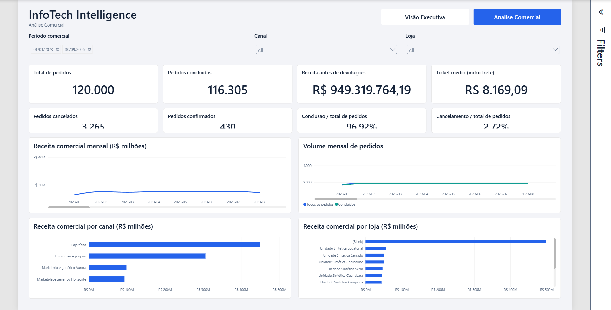
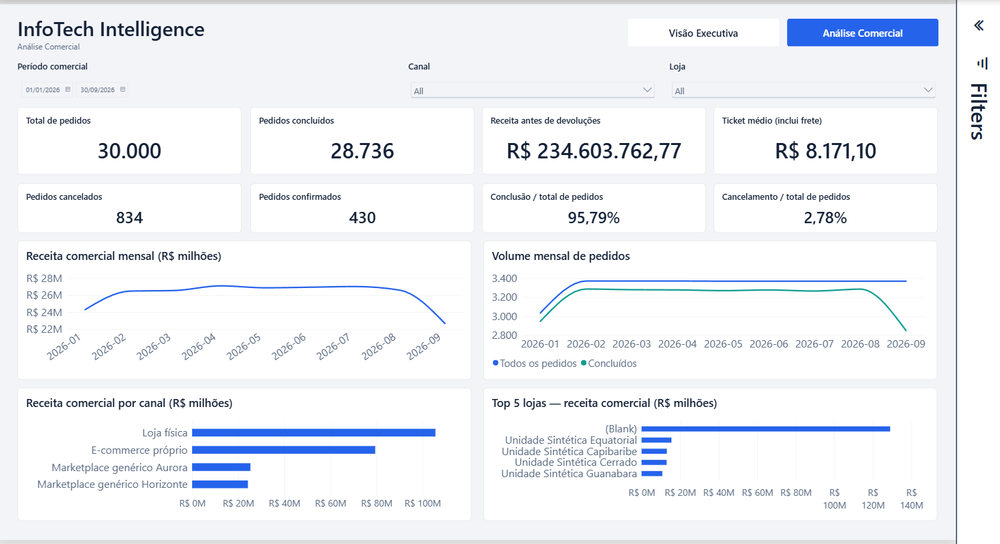
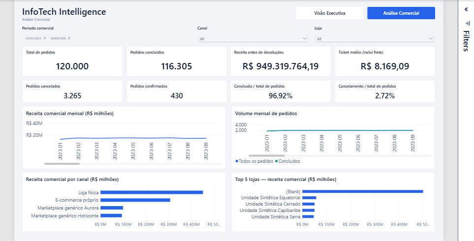
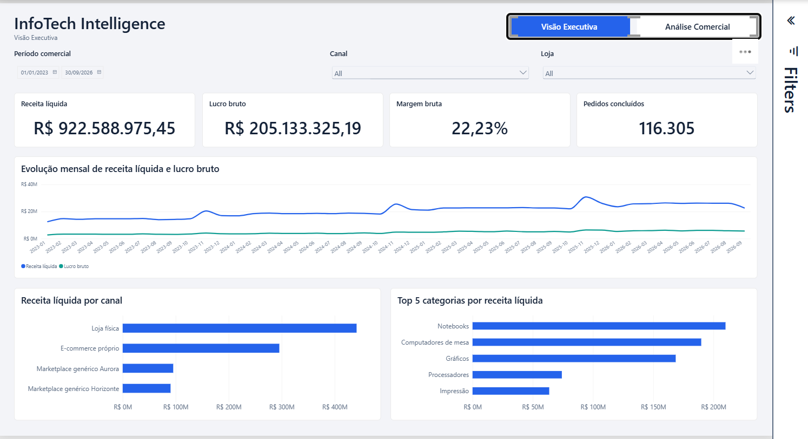

# Fase 5.2 — Dashboard de Análise Comercial InfoTech Intelligence

**Classificação:** `FASE 5.2 PASS — COMMERCIAL DASHBOARD VALIDATED`, no escopo local e com as limitações abaixo.

**Data:** 2026-10-13, America/Sao_Paulo. **Entrada:** branch `main`, HEAD `5532b42`; referência técnica anterior `3870464`.

## Implementação

Página `c5202600000000000001`, **Análise Comercial**, após Visão Executiva. Canvas 1920 × 1080, `FitToPage`, tema InfoTech preservado. São 17 visuais nativos: cabeçalho, navegador, três slicers, quatro KPIs, quatro indicadores secundários e quatro gráficos. Não foram criadas páginas futuras, medidas, tabelas, relações ou consultas Power Query.

| Bloco | Posição e área efetivas | Conteúdo |
|---|---|---|
| Cabeçalho DS-C01 | x36, y22, 1200 × 76 | Marca 30 pt; nome da página 12 pt, sem período fixo |
| Navegador | x1260, y30, 624 × 56 | Dois destinos reais, horizontal; página ativa azul/branco; texto 15 pt |
| Filtros DS-C02 | y112, altura 80; larguras 760/500/540 | Data Between; Canal e Loja dropdowns; rótulo único |
| KPIs DS-C03 | y208, 450 × 136 cada | Total, concluídos, receita pré-devoluções e ticket com frete; valor 32 pt |
| Status e taxas | y360, 450 × 100 cada | Cancelados, confirmados, conclusão/total e cancelamento/total; valor 24 pt |
| Temporais DS-C04 | x36/972, y476, 912 × 280 | Receita em BRL milhões; pedidos totais/concluídos em escala inteira separada |
| Rankings DS-C05 | x36/972, y772, 912 × 268 | Quatro canais e Top 5 membros de loja, receita pré-devoluções decrescente |

Margens 36 px e intervalos 16 px. A Visão Executiva recebeu apenas redução da largura externa do cabeçalho para 1200 px, três grupos de sincronização e um Page Navigator. Seus KPIs, gráficos, medidas, posições analíticas e proteção categoria → Pedidos permaneceram intactos.

### Tipografia real e ajuste de composição

O Desktop revelou `Axis font reduced`: o eixo configurado em 16 pt aparecia como 9 pt no painel nativo com o modo responsivo ligado. Portanto, uma propriedade PBIR sozinha não comprova a fonte efetivamente renderizada. Foi configurado `visual.objects.general.responsive=false` nos quatro gráficos comerciais; o controle nativo do eixo X passou a mostrar **16 pt**, registrado em [captura do painel](evidence/phase-5.2-axis-font-native.png). Essa captura está em contexto de seleção de abril/2026, não no estado final dos filtros.

Títulos 17 pt; categorias e eixos temporais 16 pt; legenda de pedidos 15 pt; eixos monetários das barras **14 pt**. Essa variação pontual evita compressão de valores e recupera espaço para as cinco barras. Os temporais ganharam altura; filtros passaram de 96 a 80 px mantendo largura e operação; KPIs principais conservaram 450 × 136 px. A faixa secundária foi ampliada em relação à primeira tentativa, que cortava valores.

O eixo `AnoMes` conserva ordenação por `AnoMesOrdem` e sort crescente. A largura mínima de categoria de 80 px permite rolagem temporal quando o intervalo é longo, mantendo os 45 pontos. Jan–Set/2026 mostra os nove meses; a linha de receita inclina rótulos, sem sobreposição. No intervalo completo, o visual nativo pode usar rótulos verticais. A rolagem temporal é necessária para leitura; não representa recorte dos dados.

Limitação nativa: em alguns contextos amplos/viewport reduzido, o último tick monetário pode ser abreviado com reticências; outros ticks podem quebrar o prefixo `R$` em linha separada. Títulos identificam BRL milhões e os tooltips mantêm BRL completo. Esse comportamento não é homologado como solução universal de eixo para qualquer viewport. Nomes de canais/lojas e os cinco membros do ranking foram inspecionados completos, sem scrollbar do ranking na composição final. Não se declara legibilidade em qualquer tamanho de tela.

A inspeção usou Fit to Page e capturas do bridge em escalas 1 e 2. O canvas lógico é Full HD; a resolução da captura depende do viewport, e escala 2 não equivale a operar o Desktop em zoom 100%. Não foi homologado layout móvel nem modo de leitura/tela cheia independente.

## Medidas, grão e política temporal

- `Total de Pedidos`, `Pedidos Concluídos`, `Pedidos Cancelados`, `Pedidos Confirmados`: cabeçalho e status atual/final. Os 430 `confirmed` globais não são concluídos nem cancelados; não há reconstrução histórica do status.
- `Receita Líquida de Produtos — Antes de Devoluções`: subtotal de completed menos descontos; exclui frete e não deduz devoluções. Não usa receita analítica pós-devoluções.
- `Ticket Médio — Pedidos Concluídos`: valor total de completed **incluindo frete** dividido por concluídos. Título e texto alternativo explicitam esse contrato.
- `Taxa de Conclusão` e `Taxa de Cancelamento`: denominador `Total de Pedidos` no contexto; não somar taxas. Confirmados podem fazer as duas taxas somarem menos de 100%.
- Campos: `DimCalendario[Data]`, `AnoMes`; `DimCanal[name]`; `DimLoja[name]`. Produto/Categoria não integram a página nem os grupos sincronizados.
- Período comercial por data do pedido, calendário 2023-01-01–2026-09-30, sem `TODAY()` e sem completar 2026 artificialmente.

O Top 5 de lojas usa `VisualTopN.ItemCount=5` e sort decrescente pela receita comercial. O membro `(Blank)` permanece elegível e representa pedidos sem loja, não uma localização de estoque. Há dez lojas nomeadas e o membro sem loja; outras lojas continuam no slicer. Empates no limite podem ampliar um Top N nativo; não foi criada política de desempate artificial.

### YTD/YoY

As três medidas comerciais YTD foram consultadas, preservando seus contratos. Em Jan–Set/2026: YTD R$ 234.603.762,77; mesmo YTD anterior R$ 209.080.826,98; variação 12,2072100816979% (12,21%). Sem filtro de calendário, anterior/YoY retornam BLANK, enquanto YTD atual usa a última data do calendário. Não se apresenta esse contexto global como comparação válida.

O bloco visual YTD foi **deferido como refinamento específico**, conforme a alternativa autorizada no prompt, para manter quatro KPIs, status, dois temporais e dois rankings legíveis. Não há números estáticos no relatório nem alteração de contrato. Antes de implementá-lo, reservar área própria e testar janelas equivalentes e ausência de anterior.

## Navegação e sincronização

Page Navigator nativo nas duas páginas, somente Visão Executiva/Análise Comercial; sem botões duplicados ou destinos futuros. Estados default branco/texto escuro; hover Border; selected Primary/branco. O cabeçalho não se sobrepõe ao navegador. A navegação foi acionada no modo de edição com foco no destino e Enter/Ctrl+Enter; ambos os sentidos foram observados antes e depois da reabertura.

`syncGroup` está em `visual`, com `fieldChanges=true`, `filterChanges=true`, usando `InfoTech.PeriodoComercial`, `InfoTech.Canal` e `InfoTech.Loja`. Cada grupo tem exatamente um slicer em cada página. Não houve sincronização de seleções de categorias ou produtos.

Teste efetivo: configurar Jan–Set/2026 e Loja física na Comercial → Executiva; selecionar Equatorial na Executiva → Comercial. A seleção chegou com 1.097 pedidos, 1.057 concluídos e R$ 15.501.455,58. Limpar Canal conservou a Loja; limpar Loja restaurou 30.000 pedidos no intervalo. Depois, a limpeza nativa do período retornou 120.000 pedidos e filtros All. O estado final salvo é **sem restrição nos três slicers**, preservando a escolha preexistente do usuário.

### Matriz de interações

| Origem | Destinos | Política e evidência |
|---|---|---|
| Período, Canal, Loja | Oito cartões e quatro gráficos, nas duas páginas | Filtro de dimensão, sincronizado; testes de seleção/limpeza nos dois sentidos |
| Receita mensal ou Pedidos mensais | Demais cartões e gráficos da Comercial | `DataFilter` explícito, sem misturar escalas; seleção de abril/2026 atualizou os indicadores e foi limpa |
| Ranking de canal | Cartões, temporais e ranking de loja | `DataFilter`; Loja física global retornou 62.580 pedidos e R$ 450.481.410,49 |
| Ranking de loja | Cartões, temporais e ranking de canal | `DataFilter`; sem loja global retornou 57.420 pedidos e R$ 498.838.353,70 |
| Cartões, cabeçalho, navegador | Dados analíticos | Sem seleção dimensional própria; navegador muda a página |
| Categoria da Executiva | Cartão Pedidos concluídos da Executiva | `NoFilter` preexistente preservado |

Não há bloqueio indiscriminado de interações. Seleção de gráfico não é escrita como seleção sincronizada de slicer; contexto de cross-filter é local à página. A limpeza dos pontos/barras restaura o contexto dos slicers.

## Validação funcional e reconciliação

[Evidência DAX](evidence/phase-5.2-dax-validation.json): consultas somente leitura ao modelo Import local, sete contextos reconciliados contra agregações independentes das colunas de `FatoPedidos`. Contagens idênticas, dinheiro/ticket iguais a centavos, BLANK preservado. Os 45 meses somam 120.000 pedidos, 116.305 concluídos e R$ 949.319.764,19.

| Contexto | Total | Concluídos | Cancelados | Confirmados | Receita antes de devoluções | Ticket com frete |
|---|---:|---:|---:|---:|---:|---:|
| Global | 120.000 | 116.305 | 3.265 | 430 | R$ 949.319.764,19 | R$ 8.169,09 |
| Jan–Set/2026 | 30.000 | 28.736 | 834 | 430 | R$ 234.603.762,77 | R$ 8.171,10 |
| Jan–Set/2025 | 25.732 | 25.034 | 698 | BLANK | R$ 209.080.826,98 | R$ 8.358,71 |
| Loja física, Jan–Set/2026 | 15.000 | 14.577 | 423 | BLANK | R$ 105.619.508,57 | R$ 7.245,63 |
| Equatorial, Jan–Set/2026; com/sem Canal físico | 1.097 | 1.057 | 40 | BLANK | R$ 15.501.455,58 | R$ 14.665,52 |
| 30/09/2026 | BLANK | BLANK | BLANK | BLANK | BLANK | BLANK |

| Cenário solicitado | Resultado e alcance |
|---|---|
| A — sem filtros | PASS: cartões globais e canais/lojas reconciliados |
| B — Jan–Set/2026 | PASS: quatro KPIs, status e taxas no Desktop iguais ao DAX |
| C — Jan–Set/2025 | PASS: valores acima; Confirmados BLANK preservado |
| D — Canal | PASS: seleção nativa de Loja física e ranking de canal |
| E — Loja | PASS: Equatorial e membro sem loja; não ocultar BLANK |
| F — combinação | PASS: período + Canal físico + Equatorial; agregação independente confere |
| G — navegação | PASS: ambos os sentidos e três slicers sincronizados; repetida após recuperação |
| H — limpeza | PASS: limpeza de Canal, Loja, seleção de gráfico e período; retorno ao contexto esperado |
| I — sem dados | PASS: 30/09/2026, cartões BLANK e gráficos vazios; não converter em zero |
| J — comparação temporal | PASS DAX: janelas equivalentes e guardas; bloco visual YTD deferido |

Não foi reexecutada auditoria PostgreSQL: a fase não acessou nem alterou o banco. Baselines homologados das fases anteriores foram comparados ao DAX local; as reconciliações adicionais usam as colunas importadas.

## Acessibilidade e desempenho

Textos alternativos nos 17 visuais e tab order 0–16; navegador na Executiva em 11, mantendo ordens anteriores. Tokens de contraste preservados: Primary/branco 5,17:1; Text Primary/branco 15,96:1; Text Secondary/branco 5,43:1. Página ativa identificada também pelo texto. Contorno de foco do navegador observado; dropdowns abertos/selecionados por mouse. A ativação do navegador por teclado foi exercitada, mas sequência completa de Tab, todas as ações de dropdown por teclado, leitor de tela e escala de cinza não foram comprovadas. Não houve contexto comercial com zero monetário ou valor negativo observado; formatos mantêm sinal e BLANK distinto de zero. Não se declara acessibilidade completa.

Performance Analyzer executado em 2026-10-13, **08:52:41.238–08:59:09.361** (-03:00). Exportação local fora do Git: 2.999 eventos, sessão `5db03849-0e13-43a3-942b-34e6bbf033e0`, hash e estatísticas em [resumo derivado](evidence/phase-5.2-performance-summary.json). Foram observadas 10 ações de slicer, duas de navegação, quatro de cross-highlight e uma de Refresh visuals (não refresh dos dados).

255 ciclos completos de visuais comerciais: 54–912 ms. Máximos dos temporais 912/911 ms, Canal 909 ms, Top 5 lojas 908 ms, navegador 340 ms. Método `end − start`; duração de eventos sobrepostos não é somada como tempo da página. Modelo já carregado; cache não controlado e abertura inicial fria não medida. A sessão antecede o ajuste final de modo responsivo, fontes e espaço; não é benchmark da tipografia final nem comparável diretamente aos 45–408 ms anteriores. Não se alterou DAX por hipótese de desempenho.

## Persistência e recuperação

PBIP salvo pelo Desktop e fechado normalmente; reaberto sem erro. Salvamento final identificado às 09:17 (-03:00), com slicers limpos, duas páginas, Top 5 e `responsive=false` persistidos. O Desktop regenerou sinônimos linguísticos ao salvar títulos novos; essa diferença incidental foi copiada para snapshot e o `pt-BR.tmdl` preexistente foi restaurado byte a byte com o Desktop fechado. Os demais arquivos semânticos e `report.json` permaneceram hash-idênticos ao preflight.

O usuário informou queda de energia e reinício antes do encerramento da fase. A retomada conferiu parsing de todos os JSON, hashes semânticos, artefatos de evidência e último HEAD; abriu novamente o PBIP e observou totais globais, filtros limpos, duas páginas e navegação funcional nos dois sentidos. Não houve perda identificada de definição salva ou necessidade de refresh completo.

Modelo preservado: 10 tabelas, 55 medidas, 11 Display Folders, 21 relações (19 ativas e duas inativas), Import e calendário aprovado. Após a recuperação, consultas DMV somente leitura confirmaram essas contagens, dez partições Import e zero mensagens de erro de medida. As sete reconciliações e somas mensais também foram repetidas no mecanismo recuperado. Não houve publicação ou atualização de credenciais.

## Capturas e limites técnicos

O validador geral da CLI repetiu três diagnósticos legados: ausência de `$schema` nos atalhos `.pbip`/`definition.pbir` e nome interno do tema versus nome de recurso. O schema de visualContainer 2.13.0 não estava acessível; não se declara validação integral de schema. JSON, IDs, medidas/campos, limites geométricos, referências de interação e grupos sincronizados foram conferidos localmente; o Desktop abriu, salvou e renderizou. Esses diagnósticos e `queryLimitOption=None` não foram investigados novamente.

## Design System e Git

Design System mantido em v0.2, reutilizando DS-C01–06. Navegador real, sincronização, faixa de status e política de fontes sem redução automática são candidatos documentados à v0.3; não se homologa comportamento responsivo universal. A Fase 5.3 não foi iniciada.

Preflight: seis arquivos rastreados modificados e um JSON bruto de desempenho não rastreado. Snapshot externo `C:/Users/D2/AppData/Local/Temp/ProjetoBI-phase-5.2-preserve` conserva arquivos, hashes e diff. Staging dos quatro visuais compartilhados foi construído a partir de HEAD com somente largura do cabeçalho, grupos de sync e limpeza temporal necessária para que os dois slicers iniciem coerentes. **Essa limpeza temporal já existia localmente e foi incorporada explicitamente como parte funcional da sincronização**, preservando o estado aprovado do usuário. Schema, estilo/serialização antigos, `report.json`, cultura e exportação bruta anterior permanecem fora do commit.

São elegíveis: nova página, navegador executivo, alterações compartilhadas mínimas, ordem de páginas, evidências derivadas/capturas e documentação. Commit local `feat(powerbi): implementa dashboard comercial InfoTech`; hash é informado no encerramento. Revisados status, diff/staging e ausência de segredos; checks de whitespace antes/depois. Sem push, merge, rebase ou tags.

**Resultado:** gates visual, funcional e técnico aprovados no escopo local documentado. Bloco visual YTD reservado a refinamento; acessibilidade completa, viewport arbitrário, benchmarks e diagnósticos legados não são declarados homologados.
