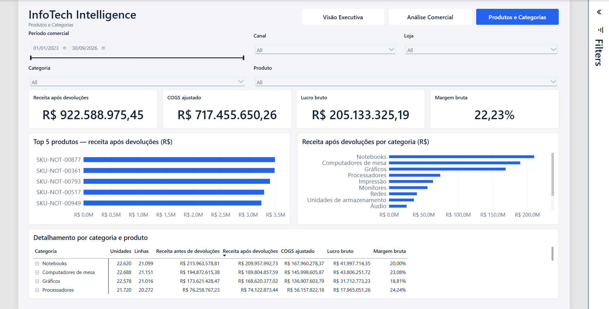

# Fase 5.3 — Produtos e Categorias

**Data:** 2026-10-13. **Entrada:** `main`, checkpoint `a0df9e9`. **Escopo:** terceira página analítica Full HD, navegação, documentação e commit local. Nenhuma alteração de DAX, TMDL, Power Query, calendário, relações ou PostgreSQL.

## 1. Dashboard

Página `d5302600000000000001`, **Produtos e Categorias**, 1920 × 1080, após Visão Executiva e Análise Comercial. Tema InfoTech existente, fundo claro, margens 36 px e espaçamento baseado em 8 px.

| Componente | Implementação |
|---|---|
| Cabeçalho | InfoTech Intelligence e nome da página; sem período estático |
| Navegação | Page Navigator nativo com três destinos, 896 × 56 px, x988/y30, fonte 15 pt; página ativa azul/branco |
| Filtros compartilhados | Um Between de 760 × 112 px, x36/y104; Canal e Loja em dropdowns; mesmos três grupos de sincronização |
| Filtros locais | Categoria e Produto, dropdowns de 760/1064 × 80 px, y224; pesquisa nativa de Produto; sem grupos de sincronização |
| KPIs | Receita após devoluções, COGS ajustado, Lucro bruto e Margem bruta; 450 × 136 px, y312; valor 32 pt/título 13 pt |
| Produtos | Top 5 por Receita Analítica Após Devoluções, decrescente, eixo SKU; nome completo no tooltip |
| Categorias | Todas as 12 categorias, decrescentes por receita; sem Top N e sem exclusão artificial de membros |
| Matriz | Categoria → Produto, inicialmente recolhida; sete medidas, totais e subtotais recalculados |

Os dois gráficos medem 912 × 320 px, y464; categorias 16 pt, eixo monetário 14 pt, títulos 17 pt e `general.responsive=false`. Unidades monetárias automáticas, com uma casa decimal nos eixos e título indicando R$. Valores completos em BRL permanecem nos cartões, matriz e tooltips. A precisão zero repetia ticks; a escala fixa em milhões transformava pequenos valores em rótulos zero. A escala automática evita essas ambiguidades.

O Top 10 inicial exigiu rolagem na altura disponível. O Top 5, alternativa autorizada, mostra cinco barras sem rolagem, preservando filtro pesquisável e matriz para o catálogo inteiro. A captura `phase-5.3-before.png` registra o teste inicial. O ranking não aplica filtro de lucro positivo: um produto com lucro negativo permanece elegível pela receita.

A matriz ocupa 1848 × 244 px, x36/y800, fonte 13 pt, layout Outline. Valores: Unidades Pedidas, Total de Linhas de Itens, Receita de Produtos — Antes de Devoluções (Itens), Receita Analítica Após Devoluções, COGS Analítico Ajustado, Lucro Bruto Analítico e Margem Bruta Analítica. BRL e margem têm duas casas; contagens são inteiras. Não há soma de margem ou alocação de frete/cabeçalho a produtos. Participação de unidades e pedidos distintos com itens ficam em tooltips apropriados, não em cartões adicionais.

Nas páginas anteriores, somente cabeçalhos (largura 920 px) e navegadores foram ajustados para três nomes. Filtros, KPIs e gráficos anteriores conservam suas definições. O estado final dos filtros é limpo, conforme a sessão salva existente; Jan–Set/2026 é cenário de teste, não seleção imposta.

## 2. Contratos e reconciliação

Consultas ADOMD somente leitura ao modelo Import do Desktop; sem conexão ou atualização de PostgreSQL. As medidas financeiras homologadas trabalham por **coorte do pedido**: itens concluídos, devolução comercial pela data do pedido, COGS original concluído menos reversão sellable. Perda non-sellable já integra o custo ajustado e não foi deduzida novamente.

O catálogo contém 1.000 IDs/SKUs/nomes únicos, 12 categorias de 83–84 produtos. Categoria/Produto filtram fatos no grão correto; nenhuma relação fato-a-fato ou distribuição de receita de cabeçalho foi introduzida.

Agregações independentes foram definidas temporariamente nas consultas, sem persistir medidas: linhas de itens, custo canônico e reversões, com elegibilidade de pedidos concluídos e relações de coorte. Foram conferidos os 1.000 produtos globalmente e em Jan–Set/2026, as 12 categorias, categoria isolada, produto isolado, combinação de filtros e ausência de dados. Receita, custo e lucro aditivos conciliam; margem agregada é lucro/receita, não soma de percentuais. Maior diferença agregada de ponto flutuante observada: aproximadamente R$ 0,00000155, abaixo da tolerância R$ 0,00001. Não é divergência de centavos.

| Contexto | Receita após devoluções | COGS ajustado | Lucro bruto | Margem exibida |
|---|---:|---:|---:|---:|
| Global | R$ 922.588.975,45 | R$ 717.455.650,26 | R$ 205.133.325,19 | 22,23% |
| Jan–Set/2026 | R$ 228.660.758,74 | R$ 176.070.150,09 | R$ 52.590.608,65 | 23,00% |
| Notebooks, Jan–Set/2026 | R$ 52.875.028,39 | R$ 41.616.385,24 | R$ 11.258.643,15 | 21,29% |
| Gráficos, Jan–Set/2026 | R$ 40.133.439,31 | R$ 32.617.437,49 | R$ 7.516.001,82 | 18,73% |
| Notebook Nova 001, Jan–Set/2026 | R$ 611.774,78 | R$ 437.327,36 | R$ 174.447,42 | 28,51% |
| Notebooks + Loja física + Equatorial, Jan–Set/2026 | R$ 3.182.873,24 | R$ 2.555.059,32 | R$ 627.813,92 | 19,72% |
| E-commerce próprio + Equatorial | BLANK | BLANK | BLANK | BLANK |
| Monitor Vértice 342, 11/02/2025 | R$ 1.355,02 | R$ 1.515,06 | −R$ 160,04 | −11,81% |

O último cenário foi encontrado por consulta de Produto/Data/Loja Pampa, sem Cliente, e reproduzido no Desktop por Produto/Data; não havia outro movimento desse produto no dia, portanto o resultado foi idêntico sem restringir a loja. Os sinais negativos apareceram nos cartões e na matriz.

O Top 5 global e Jan–Set/2026 foi comparado aos cinco primeiros resultados das consultas Top 10 independentes. A consulta gerada pelo Performance Analyzer contém `TOPN(5)` ordenado por Receita Analítica Após Devoluções, com SKU/nome para desempate, e retorna cinco linhas. `VisualTopN.ItemCount=5` é interpretado corretamente pelo Desktop com a medida do eixo/sort; não foi adicionado atributo especulativo de medida ao filtro.

Evidências: [DAX e reconciliações](evidence/phase-5.3-dax-validation.json), [saúde do modelo](evidence/phase-5.3-model-health.json). Os campos global/Jan–Set do primeiro JSON incluem somas das linhas retornadas; `directGlobal` registra os totais diretos. `queryErrors=0` refere-se às consultas finais válidas. A inspeção separada do mecanismo encontrou 55 medidas e 10 partições sem ErrorMessage, 10 tabelas, 11 pastas e 21 relações, sendo 19 ativas e duas inativas.

## 3. Validação funcional no Desktop

| Teste efetivamente executado | Resultado |
|---|---|
| Datas editáveis e slider | Alteração do início para 01/01/2026 recalculou os visuais; intervalo de um dia digitado nos dois campos. As duas alças foram movidas na terceira página: início 21/04/2023 e fim 26/04/2026, com recálculo dos indicadores. Layout final preserva 760 × 112 px |
| Categoria isolada | Gráficos e Notebooks reconciliados com DAX e matriz |
| Produto pesquisável | Prisma 472 e Nova 001 encontrados; categoria restringiu produtos elegíveis |
| Teclado/foco | Pesquisa, Tab, Enter, seta, espaço e Escape exercitados no Produto; foco visível e seleção efetiva |
| Limpeza local independente | Produto limpo preservou Categoria/Período/Canal/Loja; Categoria limpa preservou restrições gerais |
| Isolamento local | Categoria Gráficos + Prisma 472 não alteraram totais da Executiva nem Comercial ao navegar |
| Comercial → Produtos | Jan–Set/2026 + Loja física + Equatorial chegaram à terceira página; filtros locais anteriores foram mantidos |
| Produtos → Executiva/Comercial | E-commerce próprio + Equatorial chegaram às duas páginas, que exibiram ausência de dados |
| Executiva → Produtos | Limpeza de Canal/Loja chegou à terceira página, conservando Notebooks local; na verificação final, Jan–Set/2026 + Loja física + Equatorial selecionados na Executiva chegaram aos três controles da página de Produtos |
| Ranking de produto → demais | SKU-NOT-00829 selecionado: receita R$ 108.161,42, custo R$ 60.560,03, lucro R$ 47.601,39, margem 44,01%; categoria e matriz recalculadas |
| Ranking de categoria → demais | Barra Gráficos recalculou quatro cartões, produtos e matriz; novo clique restaurou contexto |
| Matriz → demais | Seleção da linha Notebooks recalculou cartões e rankings; novo clique limpou a seleção |
| Expandir/recolher matriz | Notebooks expandido mostrou nomes completos, unidades/linhas e medidas; recolhimento restaurou subtotal |
| BLANK e negativos | Ausência de dados permaneceu BLANK; lucro e margem negativos preservados |
| Catálogo completo | Rolagem do gráfico alcançou Entrada, Memória e Acessórios, sem excluí-los; matriz permite rolagem vertical e expansão |
| Navegação | Navegador nativo ativado com Ctrl+Enter, três destinos e estado ativo; rotas de ida e retorno exercitadas |
| Persistência | Salvar, fechar normalmente e reabrir, sem erro de carregamento; terceira página, filtros e matriz recolhida preservados |

Há 18 interações DataFilter explícitas entre os dois rankings/matriz e os demais seis visuais analíticos. Seleções dos gráficos e da matriz permanecem locais à página. Unidades são pedidas, não atendidas nem líquidas de devoluções; linhas não são número de produtos.

## 4. Visual, acessibilidade e desempenho

Inspeção do canvas Full HD, captura do Desktop Bridge ampliada e Fit to Page no viewport 1366 × 720 (45%). Tamanho real 100% também inspecionado por rolagem do canvas: fontes e cabeçalhos legíveis; a página inteira não cabe nesse viewport. A captura ampliada não equivale a teste físico de tela Full HD em 100%.

Textos alternativos em 14 visuais, tab order 0–13, unidades explícitas, seleção por teclado e foco visível conferidos. Contraste calculado para os tokens declarados: Text Primary/white 15,96:1, Text Secondary/white 5,43:1, Primary/canvas 14,88:1, Secondary/canvas 5,06:1 e white/azul selecionado 5,17:1. Ver [cálculo de contraste](evidence/phase-5.3-contrast.json); não é medição de cada pixel renderizado. Não foi executado teste com leitor de tela, simulador de daltonismo ou escala de cinza; não se declara certificação completa de acessibilidade.

O Performance Analyzer nativo foi gravado e exportado durante filtros, navegação e expansão/recolhimento. Foram extraídos **278 ciclos completos** dos 14 novos visuais: intervalos de 57 a 1.113 ms. Matriz: 24 ciclos, mediana 465 ms, máximo 1.113 ms; ranking de produtos: 17 ciclos, mediana 623 ms, máximo 993 ms; categorias: 17 ciclos, mediana 621 ms, máximo 992 ms. A sessão inclui seleção, expansão e contexto global; não se atribui um tempo específico a uma ação sem vínculo preciso. Cache não foi controlado, ciclos concorrentes não são somados e não houve benchmark de abertura fria. A alteração final da unidade monetária é de apresentação; não foi feita uma segunda campanha de desempenho após essa alteração.

Resumo derivado: [desempenho](evidence/phase-5.3-performance-summary.json). A exportação bruta permaneceu no Temp fora do Git e contém consultas nativas que confirmam o Top 5. Carregamento inicial observado sem erro nas reaberturas, sem medição de duração fim a fim. Nenhum freeze ou erro visual foi observado na sessão; isso não define SLA. A matriz foi exercitada recolhida e com Notebooks expandido; não se declara benchmark de todos os 1.000 produtos simultaneamente expandidos.

### Limitações nativas documentadas

- As 12 categorias não cabem simultaneamente em 320 px com fonte de categoria 16 pt. Rolagem vertical é necessária e foi testada; essa restrição não se classifica como padrão sem rolagem homologado.
- A matriz requer rolagem vertical para as 12 categorias e para produtos expandidos. Sete medidas e nomes de coluna completos couberam sem rolagem horizontal do visual nos cenários observados. Em 100%, a rolagem horizontal do **canvas** decorre da tela menor que 1920 px.
- Fit to Page reduz fontes e alvos de clique. Em tela pequena, recomenda-se aumentar zoom e percorrer a página; não se aumentaram indiscriminadamente todas as fontes.
- Em recortes pequenos, ticks monetários extensos podem quebrar linha e o último tick pode ficar parcialmente recortado no viewport reduzido. Valores completos permanecem disponíveis; não é padrão universal de eixo sem cortes homologado.
- `(Blank)` e `All` seguem a localização nativa deste Desktop; não se substituíram medidas ou criaram zeros para mascarar ausência de dados.

## 5. Design System e Git

DS-C01–06 reutilizados, com adaptações documentadas no Design System v0.2. Candidatos à v0.3: navegador de três destinos, faixa de filtros locais pesquisáveis, ranking SKU com tooltip e matriz hierárquica financeira. Não foi promovida uma nova versão do tema.

Preflight registrou alterações antigas no cabeçalho/filtros executivos, período comercial, `report.json`, `pt-BR.tmdl` e exportação `PowerBIPerformanceData.json` não rastreada. Snapshots externos preservaram esses arquivos. Após salvar no Desktop, normalizações incidentais de arquivos antigos foram comparadas e restauradas; o commit contém somente nova página, ordem, ajustes mínimos de cabeçalho/navegação e documentação/evidências desta fase. O cabeçalho executivo foi staged a partir de HEAD com apenas a nova largura, preservando alterações antigas fora do index. Nenhum arquivo de modelo ou conexão foi staged.

Commit local autorizado: `feat(powerbi): implementa dashboard de produtos e categorias`. Hash disponível no histórico Git associado a este relatório. Sem push, merge, rebase ou tag. Fases 5.4 e 5.5 não iniciadas.

## 6. Resultado

Gate visual: PASS, com rolagem nativa necessária e limite de viewport documentados. Gate funcional: PASS. Gate técnico: PASS após conferência final de persistência e commit local.

**FASE 5.3 PASS — PRODUCTS AND CATEGORIES DASHBOARD VALIDATED**

